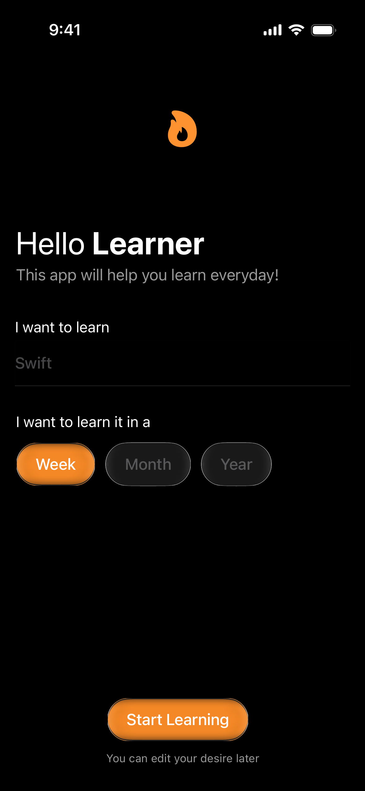
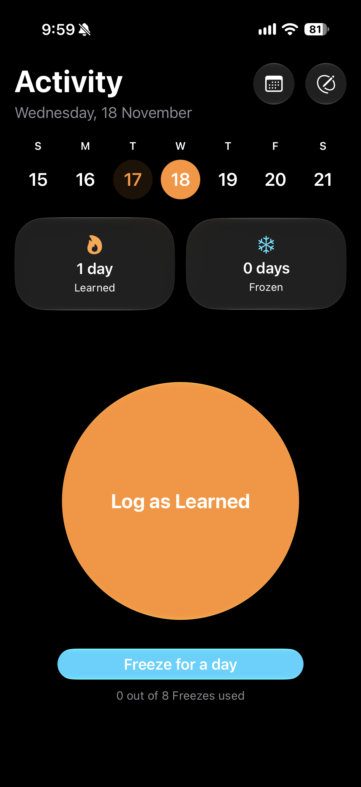
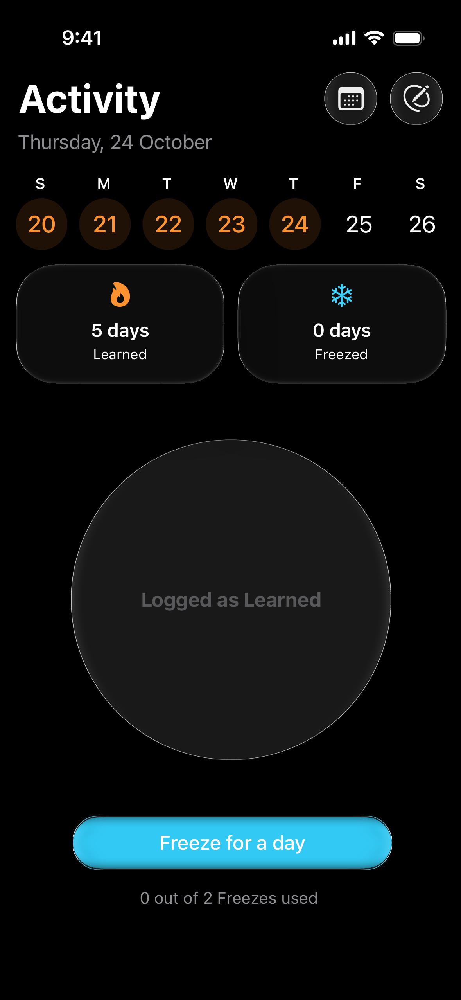
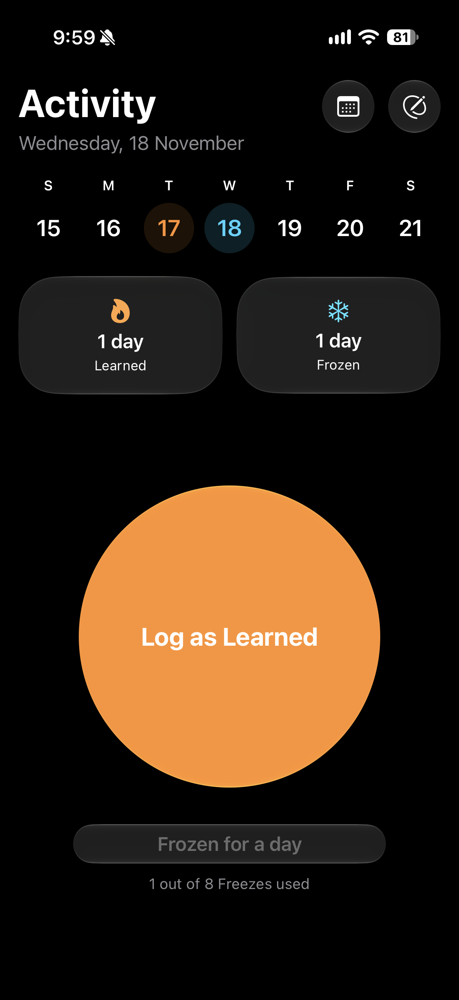
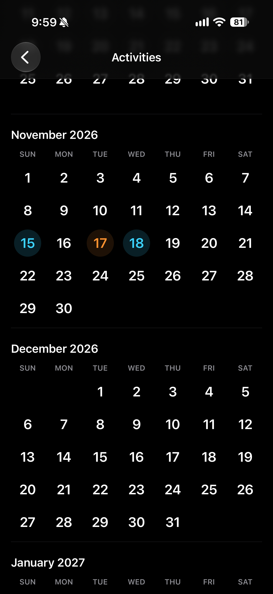
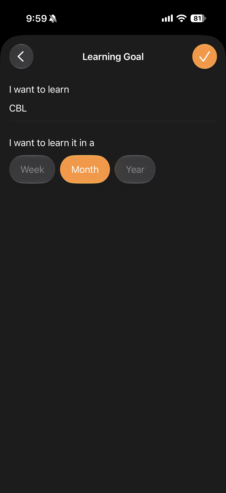
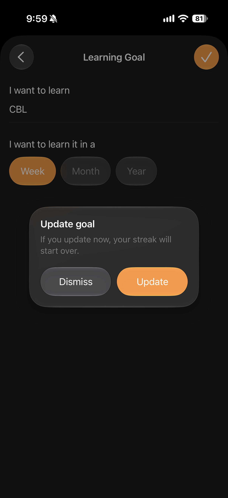
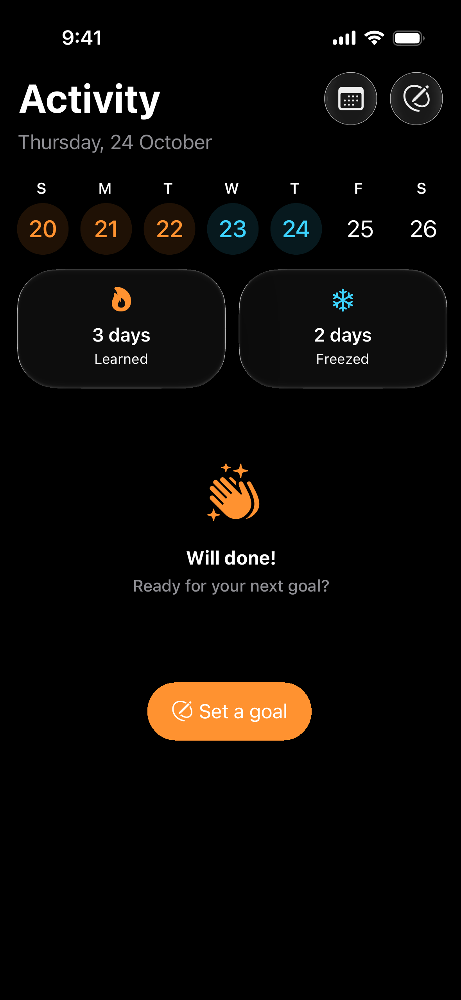
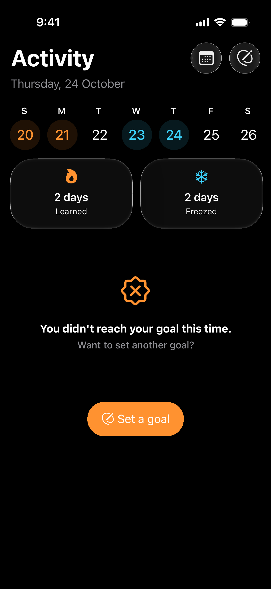

# Learning Journey 🔥

**Build a learning habit, one day at a time.**

Learning Journey is an iOS app designed to help users stay consistent with their personal learning goals. Users can choose what they want to learn, set a duration, and track their daily progress.

## Main Features

- **Personalized Learning Goals:** Create a goal and choose a duration of one week, one month, or one year.
- **Daily Learning Tracker:** Mark a day as learned to record progress.
- **Freeze Days:** Use a freeze day to maintain consistency when taking a break, within the available limit.
- **Streak Tracking:** Build a learning streak with a 32-hour window between daily logs.
- **Activity Calendar:** View previously recorded learning and freeze days.
- **Goal Management:** Update a learning goal or start a new one.
- **Goal Results:** See whether a learning goal was completed or not met.
- **Local Data Persistence:** Keep learning progress saved between app sessions.

## Technologies Used

- Swift
- SwiftUI
- MVVM Architecture
- Observation Framework
- UserDefaults
- Liquid Glass

## Project Information

Developed as an individual coding challenge at the Apple Developer Academy.
## App Screenshots

| Onboarding | Activity | Activity Logged |
|:---:|:---:|:---:|
|  |  |  |

| Freeze Day | Calendar | Edit Goal |
|:---:|:---:|:---:|
|  |  |  |

| Update Confirmation | Goal Completed | Goal Not Met |
|:---:|:---:|:---:|
|  |  |  |
ڑ
